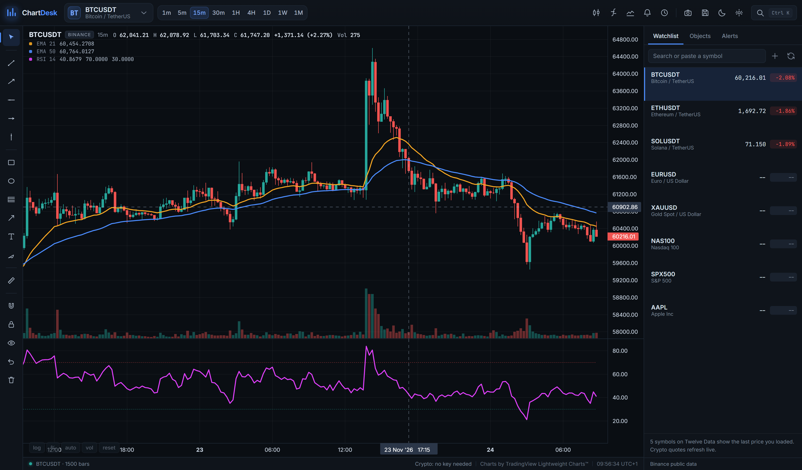

# ChartDesk

A free charting workstation that runs entirely in your browser. Candles, indicators, drawing tools, bar replay and alerts for crypto, forex, metals, indices and US stocks. No account, no subscription, no server.

**Live app:** https://uvies-philip.github.io/chartdesk/



## What it does

**Charts**
- Candlesticks, Heikin Ashi, bars, line and area
- Nine timeframes from 1 minute to 1 month
- Logarithmic and percent price scales, auto scale, volume overlay
- Crosshair OHLC readout, live last price, drag to pan, wheel to zoom

**27 indicators**, all computed in the browser
- Overlays: SMA, EMA, WMA, HMA, VWAP (session or rolling), Bollinger Bands, Keltner Channels, Donchian Channels, Supertrend, Parabolic SAR, Ichimoku Cloud, Envelope, classic Pivot Points
- Panes: Volume, RSI, MACD, Stochastic, Stoch RSI, ATR, ADX/DMI, CCI, Williams %R, Momentum, ROC, OBV, MFI, Chaikin Money Flow, Awesome Oscillator
- Every indicator has editable parameters and colour, and can be hidden without deleting it

**Drawing tools**
- Trend line, ray, horizontal line, horizontal ray, vertical line
- Rectangle, ellipse, arrow, text notes, freehand brush
- Fibonacci retracement with price labels and shaded bands
- Measure tool: shows price delta, percent and bar count
- Magnet snapping to candle open, high, low, close
- Select, move, resize, restyle, duplicate, lock, hide, delete, per symbol persistence

**Workflow**
- Bar replay with step, play and speed control
- Price alerts with desktop notifications while the tab is open
- Symbol comparison on a percentage scale
- Watchlist with live crypto quotes
- Named layouts saved locally
- Screenshot export including your drawings
- Command palette style symbol search (Ctrl K)
- Dark and light themes

## Data sources

| Market | Source | Cost |
| --- | --- | --- |
| Crypto | Binance public REST API | Free, no key, live |
| Forex, gold, silver, indices, US stocks | [Twelve Data](https://twelvedata.com) | Free key: 800 requests a day, 8 per minute |

Crypto works immediately. For everything else, create a free Twelve Data key, open Settings (gear icon) and paste it. The key is stored in your browser's localStorage and is never sent anywhere except to Twelve Data.

Because the free tier is rate limited, ChartDesk fetches history once per symbol and time frame and caches it. The active symbol refreshes about once a minute. Watchlist quotes for non-crypto symbols show the last price you loaded, which keeps you inside the daily quota.

## Keyboard shortcuts

| Keys | Action |
| --- | --- |
| `Ctrl K` | Symbol search |
| `Ctrl I` | Indicator picker |
| `Ctrl J` | Toggle theme |
| `Ctrl Shift S` | Screenshot |
| `Alt A` | Create alert |
| `1` to `9` | Switch timeframe |
| `Del` | Delete the selected drawing |
| `Esc` | Cancel tool or close dialog |

## Run it locally

No build step, no dependencies to install.

```bash
git clone https://github.com/uvies-philip/chartdesk.git
cd chartdesk
python -m http.server 8123
# open http://127.0.0.1:8123
```

ES modules need a real HTTP server, so opening `index.html` from the file system will not work.

## Deploy your own copy

The app is static, so any static host works. For GitHub Pages:

```bash
gh repo create chartdesk --public --source=. --push
gh api -X POST repos/:owner/chartdesk/pages -f source[branch]=main -f source[path]=/
```

## How it is built

```
index.html          shell and layout
css/app.css         theme system (CSS variables) and components
js/app.js           state, data flow, panels, modals, shortcuts
js/chartview.js     chart engine wrapper, panes, indicators, replay
js/indicators.js    indicator maths, pure functions over bar arrays
js/drawings.js      canvas drawing layer, hit testing, persistence
js/providers.js     data adapters and rate limiting
js/ui.js            toasts, modals, menus
vendor/             TradingView Lightweight Charts 5.3.0 (Apache 2.0)
dev/selftest.js     smoke test, loaded only with ?selftest=1
```

State lives in localStorage under `chartdesk.*`. There is no backend, so clearing site data removes your layouts and drawings.

Charts are rendered by [TradingView Lightweight Charts](https://github.com/tradingview/lightweight-charts), the open source library TradingView publishes under Apache 2.0. ChartDesk adds the indicator engine, drawing layer, panels, replay and data adapters on top.

## Honest limits

- This is not TradingView. There is no social feed, no broker integration, no server side alerts, no second based intervals and no tick data.
- Indicators are computed client side from OHLCV bars. They match the standard formulas, but they can differ slightly from another platform's output if that platform smooths or seeds differently.
- Free data is delayed or rate limited depending on the provider. Do not use this to scalp.
- Alerts only fire while the tab is open. Install the page as an app and keep it open if you rely on them.
- Twelve Data's free tier may not include every index or exchange. If a symbol returns an error, the card on the chart tells you.

## Licence

MIT for ChartDesk. Lightweight Charts is Apache 2.0, copyright TradingView, Inc. See `LICENSE`.
